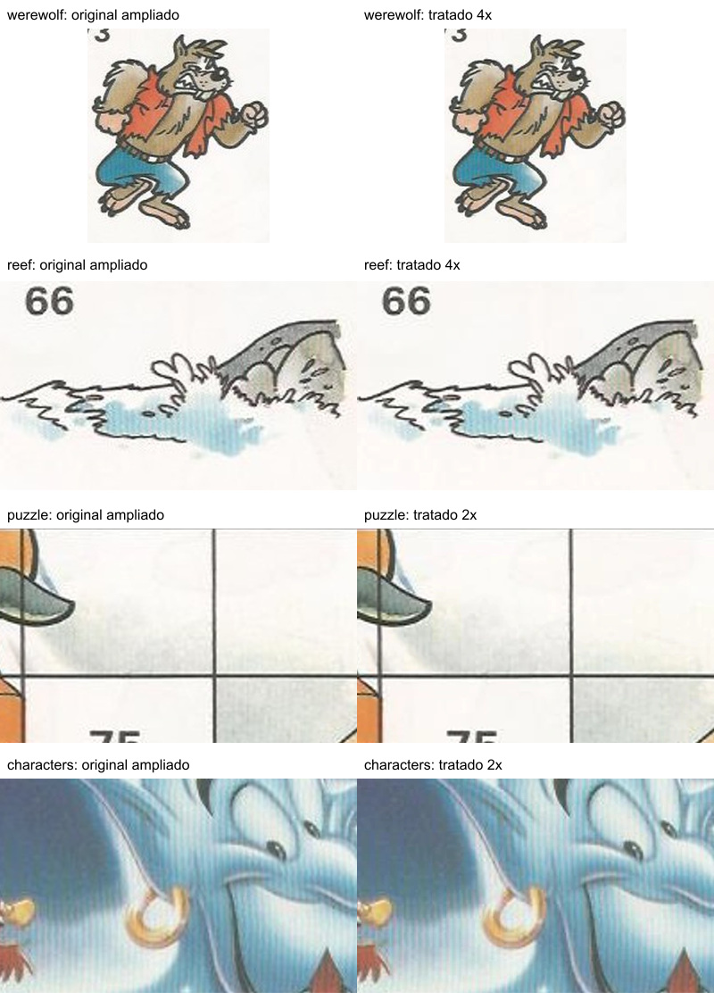

# Aprimoramento das imagens das questões

> Registro da etapa anterior de upscale conservador. As imagens usadas pelo
> aplicativo agora são as da [recriação visual revisada](recriacao-imagens.md).
> Para reproduzir apenas este tratamento antigo sem substituir os assets atuais,
> execute `npm.cmd run images:aladdin:scan`.

As 23 imagens utilizadas por 66 questões foram substituídas por versões WebP
tratadas a partir dos mesmos recortes do PDF. Foram ampliadas 12 imagens pequenas
em 4x e 11 imagens maiores em 2x, preservando exatamente a proporção e a região
original de cada recorte.

O processo é determinístico e não utiliza IA generativa:

1. Extração dos JPEGs originais do PDF, evitando recomprimir os antigos recortes.
2. Redução muito leve de ruído em luminância, guiada pelas bordas, com filtro
   bilateral 3x3. Não há ajuste de saturação, balanço de branco ou paleta.
3. Interpolação bicúbica em 2x ou 4x.
4. Nitidez leve em luminância, com limites para clareamento e escurecimento,
   sem reconstruir personagens, números, letras ou objetos.
5. WebP com qualidade 94, ajuste de subamostragem e redução de blocos do codec.

O aumento de resolução não recupera informações ausentes no scan. Borrões,
textura de impressão e detalhes já perdidos foram tratados conservadoramente;
nenhum detalhe foi desenhado ou inventado. As bordas do recorte são as mesmas,
incluindo trechos de números ou desenhos que já estavam parcialmente cortados.

## Integração e desempenho

O componente `QuestionIllustration` mantém o layout, as dimensões de exibição,
o modo `contain`, a ampliação, a rolagem e os textos de acessibilidade existentes.
A alteração nesse componente se restringe às referências de `.jpg` para `.webp`.
As medidas em `aladdin-visuals.ts` continuam sendo as medidas lógicas de exibição;
os arquivos possuem mais pixels, sem tornar as figuras maiores na tela.

Os 23 arquivos somam 3.388.708 bytes (3,23 MiB); o maior tem 430.948 bytes.
A maior imagem decodificada possui cerca de 2 milhões de pixels. O processamento
acontece antes do build; nenhum filtro ou upscale é executado durante o jogo.
Sharp é uma dependência de desenvolvimento, sem módulo nativo adicional no app.
Os JPEGs antigos foram retirados da pasta de assets para evitar duplicação.

## Reprodução e verificação

```powershell
npm.cmd run images:aladdin
```

O comando usa `scripts/aladdin-illustrations.json` para manter os mesmos recortes
e associações. O script sempre parte do PDF, tornando a execução repetível sem
acumular compressão ou filtros. A entrada PowerShell anterior também continua
funcionando e chama o mesmo processamento.

Para gerar comparações com a interpolação original, fora dos assets do app:

```powershell
node scripts/enhance-aladdin-illustrations.mjs --output tmp/aladdin-review --preview
```

O [relatório por imagem](../assets/images/questions/aladdin/enhancement-report.json)
registra dimensões, fatores de escala, peso, SHA-256 do PDF e dos arquivos,
versões das ferramentas e medidas de diferença em relação ao scan. As verificações
exigem proporção exata, desvio médio de cor inferior a 1,5 níveis por canal
(escala 0 a 255) e diferença de ida e volta próxima à interpolação sem filtros.
Nesta execução, o maior desvio médio de cor foi 0,55 e a maior diferença adicional
à interpolação foi 0,31 níveis por canal. Essas medidas complementam a inspeção
visual; isoladamente não comprovam a legibilidade ou a fidelidade semântica.

Todas as 23 figuras foram inspecionadas visualmente, com conferência ampliada
dos números, peças e sequências. Enunciados, alternativas, respostas,
associações, pontuação e estado do jogo foram preservados e conferidos por hash.

Validação: os 18 testes existentes passaram, assim como lint e typecheck. No
navegador, o asset WebP foi carregado em sua resolução ampliada e conferido nas
larguras de 320, 390 e 768 pixels, sem transbordamento horizontal na tela do
questionário, com proporção preservada e abertura/fechamento da ampliação.
Essa conferência web não substitui uma execução em aparelho Android/iOS.



## Arquivos processados

| Imagem | Resolução original | Escala | Resolução final | Bytes |
| --- | --- | --- | --- | --- |
| palace | 602x382 | 2x | 1204x764 | 82080 |
| tiger-cubs | 665x165 | 2x | 1330x330 | 82300 |
| tiger-calm | 230x208 | 4x | 920x832 | 92456 |
| tiger-attack | 250x230 | 4x | 1000x920 | 110410 |
| characters | 651x663 | 2x | 1302x1326 | 279156 |
| instruments | 759x377 | 2x | 1518x754 | 276774 |
| desert | 789x635 | 2x | 1578x1270 | 337058 |
| bay | 199x123 | 4x | 796x492 | 41990 |
| island | 178x143 | 4x | 712x572 | 39154 |
| reef | 217x127 | 4x | 868x508 | 34676 |
| cape | 216x151 | 4x | 864x604 | 41952 |
| mermaid | 162x158 | 4x | 648x632 | 47840 |
| centaur | 182x208 | 4x | 728x832 | 59810 |
| curupira | 153x235 | 4x | 612x940 | 58068 |
| dragon | 326x235 | 4x | 1304x940 | 107998 |
| unicorn | 193x202 | 4x | 772x808 | 60998 |
| werewolf | 161x189 | 4x | 644x756 | 53936 |
| puzzle | 718x706 | 2x | 1436x1412 | 295860 |
| sherazade | 635x127 | 2x | 1270x254 | 52860 |
| ali-baba-sequence | 739x578 | 2x | 1478x1156 | 430948 |
| cinema | 786x606 | 2x | 1572x1212 | 322576 |
| genie-sequence | 736x510 | 2x | 1472x1020 | 193012 |
| orchestra | 762x408 | 2x | 1524x816 | 286796 |
