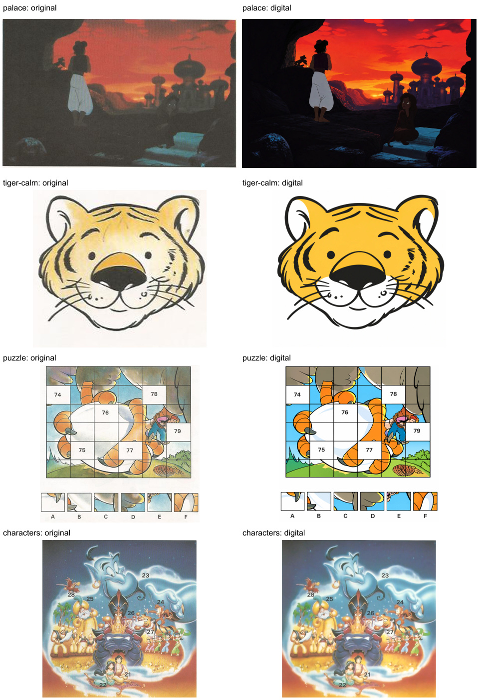
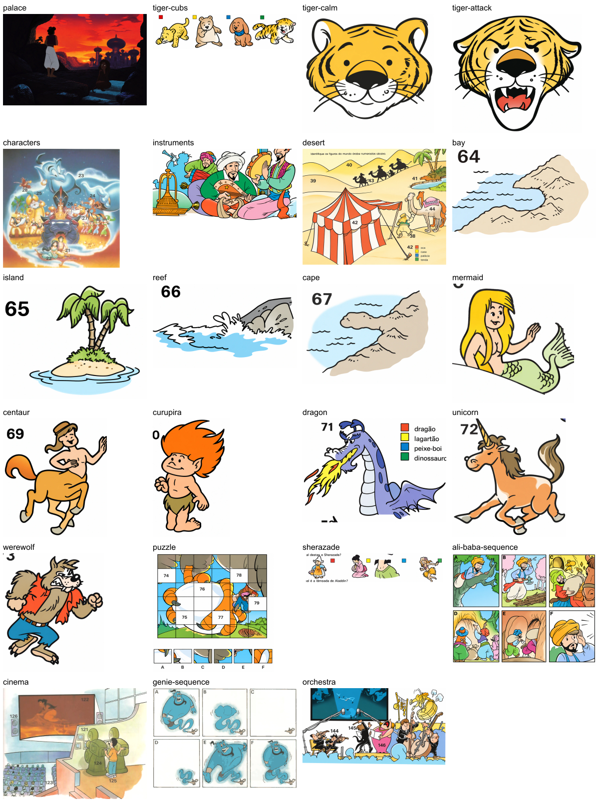

# Recriação visual para telas digitais

As 23 imagens usadas por 66 questões foram substituídas por versões com menos
textura de impressão e cores mais claras. Esta etapa substitui o upscale
conservador anterior, que mantinha a trama do papel visível.

## Método e fidelidade

Na etapa inicial, vinte imagens foram editadas com a ferramenta integrada ImageGen, usando como
alvo o recorte original do PDF, sem passar pelo upscale anterior. Os pedidos
instruíram remover papel, retícula, ruído e faixas do scan, manter os personagens,
objetos, poses, expressões, contornos, cores identificadoras, números e letras,
sem acrescentar cenas, objetos ou partes ausentes do recorte.

A imagem do palácio foi posteriormente substituída pela imagem escolhida e
fornecida pelo usuário, incluindo a menina sentada na passagem. O arquivo
recebido foi preservado em `artwork/aladdin-restored/palace-user-supplied.jpg`,
sem ajustes de iluminação, cores ou conteúdo. Seu mestre PNG contém os mesmos
pixels decodificados do JPEG. A exportação mantém a imagem inteira e suas
proporções, com margens escuras discretas para caber no espaço já existente.
As outras 22 imagens permanecem iguais às da revisão anterior.

As versões foram comparadas visualmente com cada origem. Foram conferidos em
especial a ordem dos quatro filhotes, as orelhas dos tigres, os instrumentos,
os acidentes geográficos, os pés do Curupira, as lacunas e peças do quebra-cabeça,
as letras dos quadros de Ali Babá e os números da orquestra. O quebra-cabeça
continua com as peças D, B, A, F, C e E para as lacunas 74 a 79, respectivamente.

Esses redesenhos são restaurações interpretativas: não são reproduções idênticas
pixel a pixel. A revisão verifica o conteúdo observável usado nas questões;
variações pequenas de traço e preenchimento podem existir.

A ferramenta bloqueou a saída da geração de três imagens: `characters`,
`cinema` e `genie-sequence`, sem fornecer uma justificativa específica além da
categoria genérica do filtro. Elas foram restauradas diretamente dos pixels
originais, com redução de trama guiada por bordas e limpeza de cores, sem
sintetizar rostos, objetos ou texto. A sequência do Gênio também passou por
vetorização determinística de contornos e cores. Nessas três figuras, a limpeza
é mais limitada para preservar informações que não poderiam ser redesenhadas
com segurança a partir da fonte disponível.

Nas faixas largas dos filhotes e de Sherazade, foram retiradas apenas as margens
brancas adicionais da saída da ferramenta. A exportação usa `contain` para não
esticar as figuras. Partes já cortadas na origem continuam cortadas; não foram
completadas figuras nem números fora do enquadramento original.

## Integração

Os 23 mestres PNG ficam em `artwork/aladdin-restored/`. Os prompts utilizados
estão em [prompts.json](../artwork/aladdin-restored/prompts.json), e os arquivos
revisados, seus hashes e exceções estão em
[restoration-manifest.json](../artwork/aladdin-restored/restoration-manifest.json).
Esses mestres não são importados pelo aplicativo.

O jogo utiliza somente os WebP em `assets/images/questions/aladdin/`, com os
mesmos nomes e as mesmas associações. As 23 imagens exportadas somam 2.982.854
bytes (2,84 MiB), menos que os 3.388.708 bytes da etapa anterior. Nenhuma edição
ou geração acontece durante o jogo e nenhuma nova biblioteca nativa foi
adicionada ao aplicativo.

Enunciados, alternativas, respostas, lógica, pontuação, estado, associações,
componente de ilustração e tokens de design foram conferidos por SHA-256 e
permanecem iguais aos do início desta etapa. As dimensões lógicas de exibição
também permanecem iguais, com a proporção original em todos os arquivos.

## Reprodução e validação

A versão anterior do palácio recebeu uma revisão adicional de iluminação: sombras do
primeiro plano foram clareadas com uma curva de luminância, preservando as cores
luminosas do pôr do sol. A alteração utiliza somente os pixels existentes; não
acrescenta feições às silhuetas ou novos elementos. A versão anterior foi
preservada em `artwork/aladdin-restored/palace-dark-v1.png`. A tentativa de edição
com ImageGen foi bloqueada pela ferramenta e não produziu uma saída utilizada.
O [registro de iluminação](../artwork/aladdin-restored/palace-lighting.json)
contém o prompt tentado e o método daquela etapa. Essa versão foi arquivada em
`artwork/aladdin-restored/palace-lighting-v2.png` e substituída pelo arquivo
fornecido pelo usuário. O script de iluminação agora recusa sobrescrever a
imagem escolhida pelo usuário. `npm.cmd run images:aladdin` exporta o mestre atual.

```powershell
# Exportar os mestres revisados para os WebP usados no app:
npm.cmd run images:aladdin

# Conferir hashes, proporções, associações e gerar as pranchas de comparação:
node --experimental-strip-types scripts/review-aladdin-artwork.mjs

# Reproduzir a restauração direta dos três casos sem geração:
node scripts/restore-aladdin-scan.mjs --id characters
node scripts/restore-aladdin-scan.mjs --id cinema
node scripts/restore-aladdin-scan.mjs --id genie-sequence --vector
```

O exportador exige que o SHA-256 de cada mestre corresponda ao arquivo aprovado
no manifesto e que o PDF corresponda à origem revisada. Uma edição posterior
dos mestres precisa ser revisada antes de atualizar seus hashes.

Verificações realizadas: todas as 23 imagens presentes e decodificáveis, 66
associações preservadas, proporções exatas, arquivos protegidos intactos,
18 testes existentes, lint e typecheck. A revisão visual das imagens não
substitui uma execução em aparelho Android/iOS.

## Comparação

À esquerda, o recorte original; à direita, a versão atual. A última linha
documenta também o limite da restauração direta sem redesenho.




